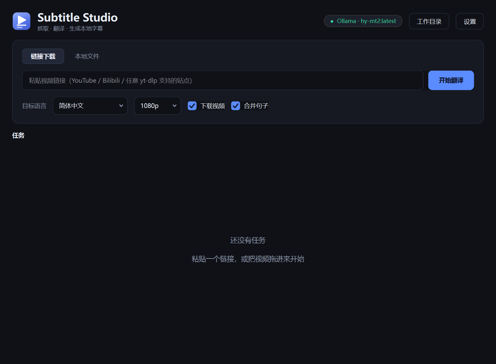
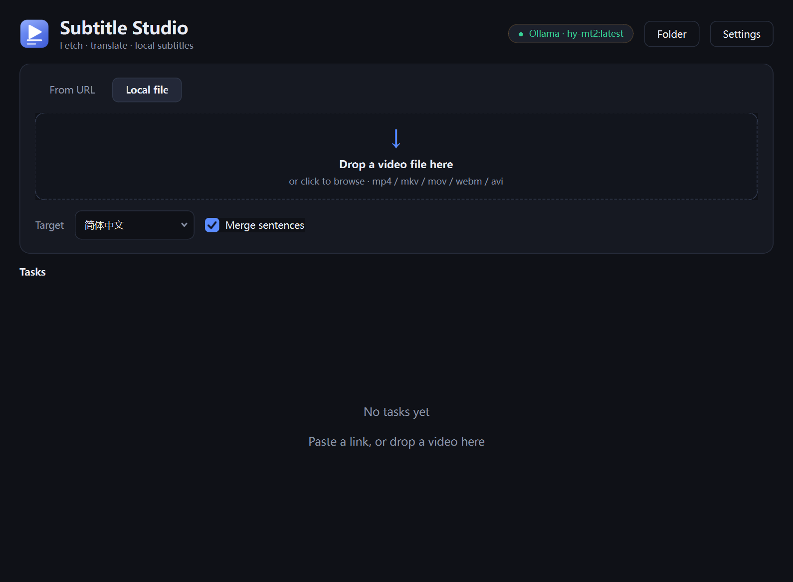
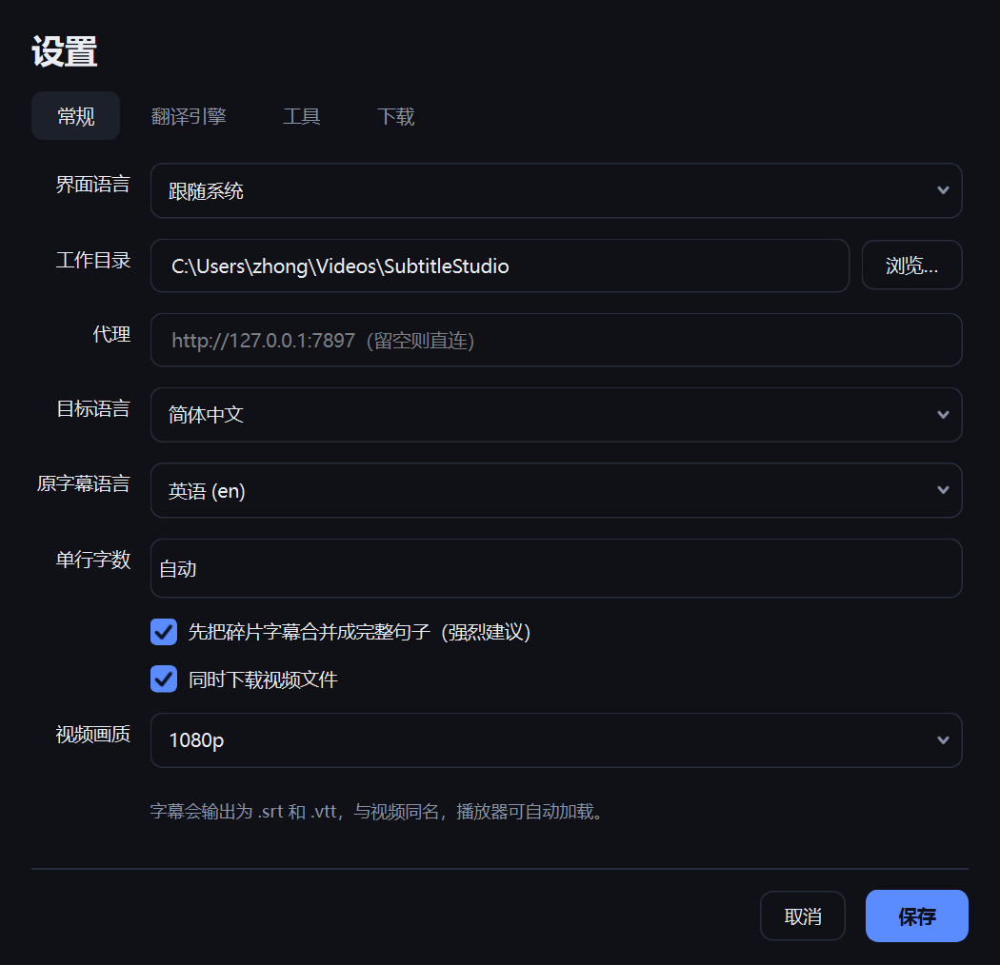

# Subtitle Studio

把任意视频变成能看懂的字幕。粘贴一个链接（或拖进一个本地文件），它会抓取原字幕、合并成完整句子、用本地模型或你自己的 API 翻译，然后在视频旁边写出 `.srt` / `.vtt`。

**原生 Qt 界面**（PySide6 / Qt Widgets）——不用 Electron、不用 WebView、不套浏览器内核。Windows / macOS / Linux 同一套代码。

[English](README.md) | **简体中文**

> **安装包没有签名。** 双击 MSI 时 Windows SmartScreen 会提示「Windows 已保护你的电脑」，
> 点 **更多信息 → 仍要运行** 即可；文件本身是完整的，只是没有证书声明发布者。
> 详见下面的[安装](#windows-安装包推荐)一节。



## 为什么需要它

YouTube 自带的「自动翻译」字幕走 `api/timedtext?...&tlang=` 接口。在没有 PO token 的会话上，这个接口返回 429 或空响应——实测**与出口 IP 无关**（换到完全不同的 Cloudflare WARP 出口同样是 429，而那边 YouTube 反而直接要求登录验人）。

但**原始语言的字幕轨是正常的**。所以不去求 YouTube 给译文，抓原文自己翻。

## 功能

- **链接**：任意 yt-dlp 支持的站点（YouTube / Bilibili / …）。可以只取字幕，也可以连视频一起下。
- **本地文件**：自动找内嵌文本字幕轨并提取；没有字幕轨时可选用 Whisper 语音识别。
- **翻译引擎**：本地 Ollama，或任意 OpenAI 兼容 API（DeepSeek / SiliconFlow / LM Studio / vLLM / llama.cpp）。
- **工具自举**：启动时检查 yt-dlp，缺失就自动下载。
- **下载参数**：浏览器 Cookie、TLS 指纹伪装、任意额外 yt-dlp 参数。
- **完整 i18n**：简体中文 / English，或跟随系统；切换即时生效，不用重启。
- **可配置输出目录**；字幕与视频同名，播放器会自动加载。
- **先合并句子再翻译**（[原因](docs/DEVELOPMENT.md#two-implementation-notes)）——把 2 秒一条的碎片直接丢给模型会翻出很离谱的东西。
- 任务队列、实时进度、随时取消、一键打开目录。

## 环境要求

| | |
|---|---|
| Windows 10/11 | 不需要额外装东西，安装包自带运行时 |
| 从源码运行 | Python 3.10+（开发用 3.11），`pip install -r requirements.txt` |
| yt-dlp | 缺失时首次运行会自动下载 |
| ffmpeg | 可选。合并高画质视频、提取内嵌字幕时需要 |
| 翻译 | Ollama 里的模型，或任意 OpenAI 兼容接口 |

## 安装

### Windows 安装包（推荐）

从 [Releases](../../releases) 下载 `Subtitle Studio.msi` 运行。

> **未签名的构建。** SmartScreen 会提示「Windows 已保护你的电脑」，点 **更多信息**，再点
> **仍要运行**。安装到 `C:\Program Files\Subtitle Studio`，创建开始菜单和桌面快捷方式。
> 想彻底去掉提示需要代码签名证书（OV 证书约 $150–300/年），或者申请
> [SignPath Foundation](https://signpath.io) 的免费开源签名。两种方案都写在
> [开发文档](docs/DEVELOPMENT.md#code-signing)里。

### 从源码运行

```bash
git clone <本仓库>
cd subtitle-studio
pip install -r requirements.txt
python main.py
```

Windows 也可以双击 `run.ps1`；Linux/macOS 用 `./run.sh`。

## 首次使用

1. 右上角会显示检测到的引擎，例如 `● Ollama · hy-mt2`。
2. 如果显示「未配置引擎」，点它打开 **设置 → 翻译引擎**：
   - **Ollama**：填服务地址，点「刷新模型」，选一个翻译模型；或者
   - **OpenAI 兼容 API**：填 Base URL（要带 `/v1`）、Key、模型名。
   - 点「测试翻译」确认能出字。
3. 在 **设置 → 常规** 里填代理（例如 `http://127.0.0.1:7897`），否则拉不到被墙的站点。
4. 粘贴链接 → 开始翻译。

专用翻译模型（腾讯混元 MT、Qwen 等）效果明显好于通用对话模型。

## 使用

### 从链接

粘贴 URL，选目标语言和画质，点 **开始翻译**。关掉「下载视频」就只拿字幕。

### 本地文件

切到 **本地文件**，把视频拖进去。有内嵌文本字幕轨就直接提取翻译；没有的话去 **设置 → 工具** 开启语音识别。

### 下载参数

**设置 → 下载**，给需要登录或反爬的站点用：

| 项 | 说明 |
|---|---|
| 从浏览器读取 Cookie | `--cookies-from-browser`。**Chrome / Edge 的 Cookie 被 DPAPI 加密，yt-dlp 解不开**（`Failed to decrypt with DPAPI`）；**Firefox 可以正常读取** |
| 或 cookies.txt | 自己导出的 Cookie 文件，走 `--cookies`。用 Chrome 的话建议走这条 |
| 伪装 TLS 指纹 | `--impersonate`。**不要对 YouTube 开**——YouTube 排斥这个指纹，会直接 `No video formats found`。这是给别的站点用的 |
| 额外参数 | 原样追加给 yt-dlp，按 shell 规则解析（支持引号），例如 `--extractor-args "youtube:player_client=web"` |

两个预设按钮覆盖常见情况：「应对确认不是机器人」切到 Firefox Cookie 并清空伪装；「快速：只取字幕」关掉视频下载。

yt-dlp 的常见失败（需要登录、Cookie 解不开、伪装导致解析失败、引擎连不上）会被翻译成可执行的提示，而不是抛原始报错。

### 界面语言

**设置 → 常规 → 界面语言**：跟随系统 / 简体中文 / English。切换后立刻生效，包括队列里已有任务卡上的按钮。

语言下拉框会显示翻译完成度（如 `日本語 66%`），半成品一眼可见。

## 界面

| 本地文件 | 设置 |
|---|---|
|  |  |

## 命令行模式

批处理和排错时用：

```bash
python main.py --cli "https://www.youtube.com/watch?v=xxxx" --model hy-mt2
python main.py --cli "D:\movie.mkv" --target 简体中文
python main.py --cli "URL" --api-base https://api.deepseek.com/v1 --api-key sk-... --api-model deepseek-chat
```

常用参数：`--no-video`（只取字幕）、`--quality 720`、`--proxy`、`--workdir`、`--src en`。

## 已知限制

- 纯音乐 / 无语音的视频没有原文可抓，除非开启语音识别。
- 输出是句子级而不是逐片段，换行由标点决定。
- 没有 JS runtime（deno）时 yt-dlp 可能少列一些字幕语言；原语言字幕不受影响。
- 语音识别需要 `pip install faster-whisper`，首次使用会下载模型（`small` 约 500MB）。

## 参与贡献

- [开发文档](docs/DEVELOPMENT.md) —— 目录结构、构建 MSI、代码签名、CI。
- **翻译**：`app/locales/` 下一个语言一个 JSON 文件，不用改代码。开 PR 前先跑
  `python tools/check_i18n.py --strict`。

